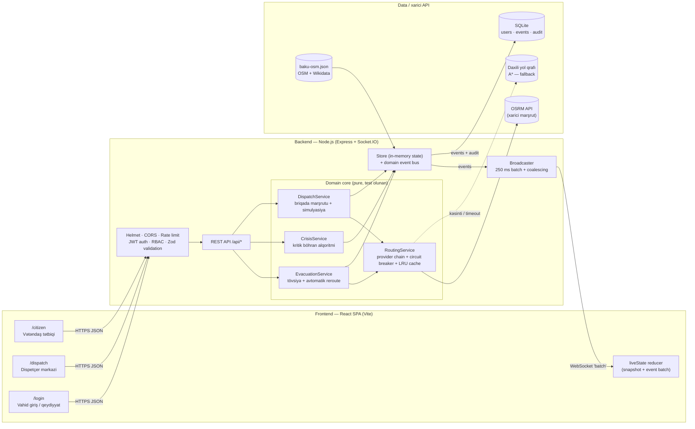

# Arxitektura qeydi — PaniGo

## 1. Ümumi sxem



### Sorğu axını (misal: vətəndaş SOS göndərir)
1. `POST /api/citizen/sos` → Helmet/CORS → global rate limit → JWT → RBAC (`sos:create`) → hər vətəndaş üçün ayrıca limiter → Zod validasiyası.
2. `Engine.createSos` SOS-u `Store`-a yazır və `sos.upsert` hadisəsi yaranır.
3. `CrisisService.evaluateSos` yalnız son 5 dəqiqənin siqnallarını yoxlayır. 4-cü fərqli vətəndaşdan siqnal gələndə `CrisisAlert` yaranır və tövsiyə əlavə olunur: ixtisaslaşmış ən yaxın briqada və ən yaxın ehtiyat məntəqə.
4. `Broadcaster` hadisələri 250 ms ərzində yığır, eyni obyektə aid hadisələri birləşdirir və otaqlara (`dispatch`, `public`, `citizen:<id>`) bir `batch` mesajı kimi göndərir.
5. `EventLog` hadisələri və audit qeydlərini SQLite-a saniyədə bir dəfə, tək tranzaksiya ilə yazır.

## 2. Modullar

| Qat | Fayl | Məsuliyyət |
|---|---|---|
| Ortaq kontrakt | `shared/types.ts` | Server və klient üçün vahid data modeli, böhran qaydalarının həddləri |
| Domen (təmiz) | `server/src/domain/*` | `geo` (məsafə, xətt–dairə kəsişməsi), `crisisEngine`, `recommendation`, `roadNetwork` (A*) |
| Marşrutlaşdırma | `server/src/routing/*` | `RoutingProvider` strategiyası, `OsrmProvider`, `SimulatedProvider`, `CircuitBreaker`, `RoutingService` |
| Tətbiq servisləri | `server/src/services/*` | `Engine` (composition root), `EvacuationService`, `CrisisService`, `DispatchService`, `Store` |
| Nəqliyyat | `server/src/http/*`, `realtime/*` | REST, sxemlər, middleware, WebSocket broadcaster |
| Təhlükəsizlik | `server/src/security/*` | RBAC icazə matrisi, JWT, `UserRepository` (scrypt + SQLite) |
| Davamlılıq | `server/src/persistence/eventLog.ts` | Append-only hadisə və audit jurnalı |
| Klient | `client/src/*` | Səhifələr, `useLive` (socket + snapshot), `liveState` reducer, i18n |

Arxitektura **hexagonal** prinsipinə əsaslanır. HTTP və WebSocket adapterləri yalnız `Engine` fasadı ilə danışır. Store, provider və ya nəqliyyat qatını dəyişmək domen məntiqinə toxunmur.

## 3. Əsas alqoritmlər

### 3.1 Məntəqə tövsiyəsi (`recommendation.ts`, `evacuationService.ts`)
- Yalnız `open` statuslu məntəqələrə baxılır. Doluluğu ≥90% olan məntəqələr "dolu" sayılır və sıranın sonuna keçir.
- **Proqnoz doluluq** = (hazırkı + yolda olanlar) / tutum. Bu, hamının eyni yarıboş məntəqəyə yığılmasının qarşısını alır (herding effect).
- İlk 3 namizəd üçün real marşrut hesablanır. Son seçim piyada vaxtına görə edilir, proqnoz doluluq 70%-i keçdikdə vaxt cəriməsi əlavə olunur.

### 3.2 Avtomatik alternativ marşrut
- **Yol bağlandı** (`closure.add` və ya `/api/sim/traffic/closure`): marşrutu bağlı dairədən keçən bütün aktiv sessiyalar yenidən planlanır (`reason: road_closed`).
- **Məntəqə ≥90% doldu və ya bağlandı**: həmin məntəqəyə gedən sessiyalar köhnə məntəqə istisna edilməklə yenidən planlanır (`point_full`, `point_closed`).
- Yeni plan `plan.update` hadisəsi ilə yalnız həmin vətəndaşın otağına göndərilir. UI banner, köhnə marşrutu (boz, qırıq xətt) və yeni marşrutu göstərir.

### 3.3 Kritik böhran alqoritmi (`crisisEngine.ts`)
```
Qayda A: count_distinct(citizenId) ≥ 4
         üzv SOS-lar: status = 'new'  ∧  now − t ≤ 5 dəq
                      ∧ (eyni zona  ∨  məsafə(yeni SOS) ≤ 500 m)
Qayda B: open məntəqədə occupancy / capacity > 95%
```
- Eyni zonada və ya 500 m daxilində açıq həyəcan varsa, yeni həyəcan yaranmır, mövcud həyəcan genişlənir (dedup).
- Briqada artıq təyin olunmuş SOS-lar sayılmır. Operator qərar verəndən dərhal sonra eyni həyəcan təkrar yaranmır.
- **1 klik icra** (`CrisisService.execute`): qərar anında state yenidən yoxlanılır. Tövsiyə olunan briqada artıq məşğuldursa, növbəti ən uyğun briqada seçilir. Sonra briqada göndərilir, ehtiyat məntəqə açılır və həddindən artıq dolu məntəqəyə gedən vətəndaşlar yenidən planlanır. İkinci klik `409` qaytarır (idempotentlik). Qərar audit jurnalına yazılır.

### 3.4 Davamlı marşrutlaşdırma (`routingService.ts`)
`ROUTING_PROVIDERS=osrm,simulated`: provider-lər prioritet sırası ilə çağırılır.
- OSRM bağlı yolları bilmir. Ona görə 3-ə qədər alternativ marşrut istənilir və bağlı dairədən keçməyən ilk marşrut seçilir.
- Hər provider-in öz **circuit breaker**-i var: 3 ardıcıl xətadan sonra 30 saniyəlik açıq dövr, sonra yarıaçıq yoxlama. Timeout 2,5 saniyədir.
- Bütün provider-lər işləmirsə, düz xətt üzrə istiqamət və təxmini ETA qaytarılır. Vətəndaş heç vaxt cavabsız qalmır.
- LRU keş (2000 qeyd). Açar: koordinatlar + aktiv bağlanmaların id-ləri.

## 4. Challenge drop-lara uyğunlaşma

Sistem 4 gözlənilən dəyişiklik növü üçün əvvəlcədən elastik layihələndirilib:

| Drop | Hazır mexanizm | Dəyişiklik edilməli yer |
|---|---|---|
| **Yeni rol** | `PERMISSIONS` matrisi data kimi saxlanılır (`security/auth.ts`). Rol hər sorğuda user store-dan yenidən oxunur. Admin UI-dan rol təyin edilir. | Matrisə bir sətir, `Role` tipinə bir dəyər, UI-da rola uyğun görünüş |
| **Yeni dil** | Asılılıqsız i18n (`client/src/i18n`). `Dict` tipi bütün açarların tərcüməsini TypeScript səviyyəsində məcburi edir. | `ru.ts` faylı + `LANGS`-a bir sətir. Tərcümə çatışmırsa, build uğursuz olur |
| **Xarici API kəsintisi** | Provider chain + circuit breaker + fallback qraf + düz xətt degradasiyası + keş. Chaos açarı: `POST /api/sim/outage`. Tile URL `VITE_TILE_URL` ilə dəyişdirilə bilər. Real data JSON kimi repodadır. | Yeni provider = `RoutingProvider` interfeysi ilə bir sinif + `ROUTING_PROVIDERS` env |
| **Yüksək yük** | WebSocket batch və coalescing (250 ms) · SOS window scan · LRU marşrut keşi · SQLite yazılarının batch edilməsi · klientdə SOS sayına limit (2000) · rate limiting · `scripts/loadtest.mjs` | Üfüqi miqyas: `Store` → Redis, Socket.IO Redis adapter. Fasad dəyişmir |
| **Təhlükəsizlik tələbi** | JWT (issuer yoxlanışı) · scrypt + salt + constant-time müqayisə · RBAC · Zod validasiya + `<>` sanitizasiyası · Helmet · CORS whitelist · 32 KB body limiti · auth üçün ayrıca rate limit (20/dəq) · SOS spam limiti · bloklanmış hesabın dərhal kəsilməsi · audit jurnalı · productionda `JWT_SECRET` məcburidir | — |

### Ölçülmüş yük göstəriciləri
Tək Node prosesi, lokal noutbuk, `DB_FILE=off`, simulyasiya söndürülüb, 200 paralel bağlantı:

| Ssenari | Nəticə |
|---|---|
| 2000 SOS (soyuq start) | 0 xəta · 1671 sorğu/s · p50 116 ms · p95 132 ms |
| Əlavə 2000 SOS (pəncərədə 4000 aktiv SOS) | 0 xəta · 1229 sorğu/s · p50 154 ms · p95 203 ms |

## 5. Data modeli (SQLite)
- `users(username PK, name, role, phone, disabled, created_at, last_login_at, salt, hash)`
- `events(id, kind ['event'|'audit'], type, payload JSON, at)`: append-only. Hadisədən sonrakı təhlil və yenidən oynatma (replay) üçün istifadə olunur.

Operativ state yaddaşdadır (aşağı gecikmə üçün). Davamlı saxlanması lazım olan hər şey (hesablar, qərarlar, hadisələr) SQLite-a yazılır.
